<div align="center">


# Dossiq

**Ask your company documents anything. Get answers you can check.**

Dossiq reads your PDFs, Word files, and notes, then answers questions in plain language.<br/>
Every answer points to the exact page it came from.

<br/>


<br/>

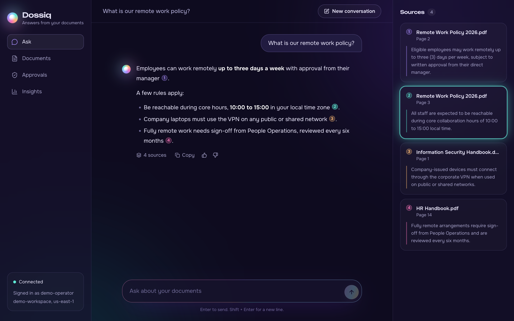

</div>

<br/>

## What is Dossiq?

Every company has answers buried in documents. Policies, handbooks, contracts, guides. Finding the right line takes time, and people often guess.

Dossiq fixes that. You upload your files once. After that, anyone can ask a question like *"How many days can I work from home?"* and get a short, clear answer.

What makes it trustworthy:

- **It only uses your documents.** It does not make things up from the internet.
- **It shows its work.** Each fact has a small colored number. Click it, and you see the exact passage and page.
- **It says when it does not know.** If nothing in your files covers the question, it tells you so.
- **It asks before risky actions.** Requests to delete, export, or change things go to an admin first.

<br/>

## Highlights

| | |
|---|---|
| 🎯 **Cited answers** | Every claim links to a page in a real document. Colors match the source cards. |
| 🧠 **Remembers the conversation** | Follow-ups like "summarize that" just work. Chats survive a page reload. |
| 🔐 **Access control** | People only get answers from documents they are allowed to see. |
| 🛡️ **Guardrails** | Blocks prompt-injection tricks. Hides answers that would leak keys or passwords. |
| ✋ **Human approval** | Risky requests wait in an admin queue. Nothing runs on its own. |
| 📜 **Audit trail** | Uploads, blocks, and decisions are all recorded. |
| 📊 **Insights** | See document health, answer feedback, and guardrail activity at a glance. |
| ✨ **Polished UI** | Animated assistant, word-by-word answers, drag-and-drop uploads, works on phones. |

<br/>

## A quick tour

> The screenshots below use sample documents.

### 1. Ask a question

Start with a blank page, or tap a suggestion. The orb is Dossiq. It breathes while it works and tells you what it is doing.

<table>
  <tr>
    <td width="50%">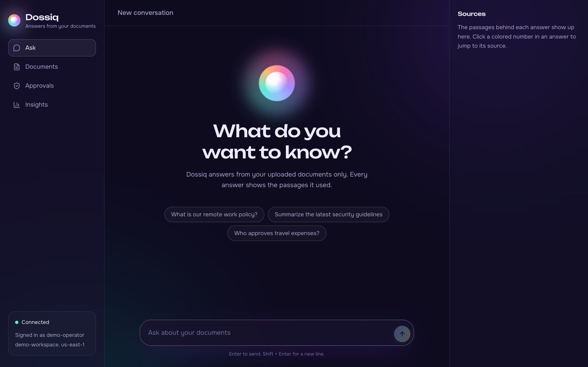</td>
    <td width="50%">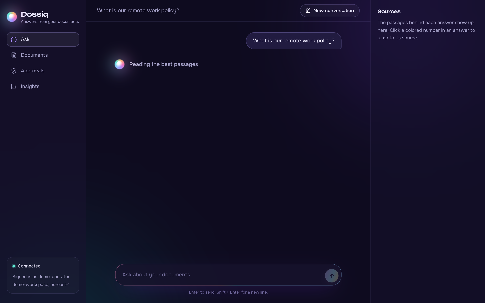</td>
  </tr>
  <tr>
    <td align="center"><sub>Ready for your first question</sub></td>
    <td align="center"><sub>Searching, reading, then writing</sub></td>
  </tr>
</table>

### 2. Get an answer you can check

The answer appears word by word. Each colored number is a citation. Click one, and the matching source card lights up on the right with the exact quote and page.


### 3. Add your documents

Drop a PDF, Word file, text file, or Markdown note. Dossiq shows each step as it uploads and indexes the file. Every document shows whether it is ready to use.

<table>
  <tr>
    <td width="50%">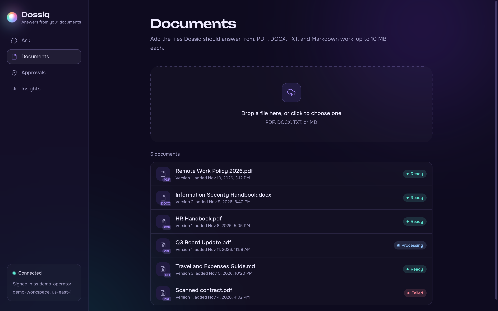</td>
    <td width="50%">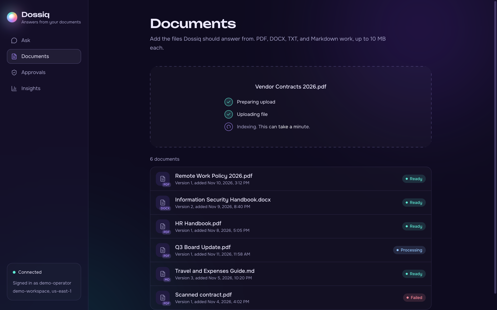</td>
  </tr>
  <tr>
    <td align="center"><sub>Your library, with live status</sub></td>
    <td align="center"><sub>Upload progress, step by step</sub></td>
  </tr>
</table>

### 4. Keep a human in the loop

If someone asks Dossiq to delete, export, send, or change a policy, it does not act. It creates an approval request instead. An admin reviews it in the Approvals tab.

<table>
  <tr>
    <td width="50%">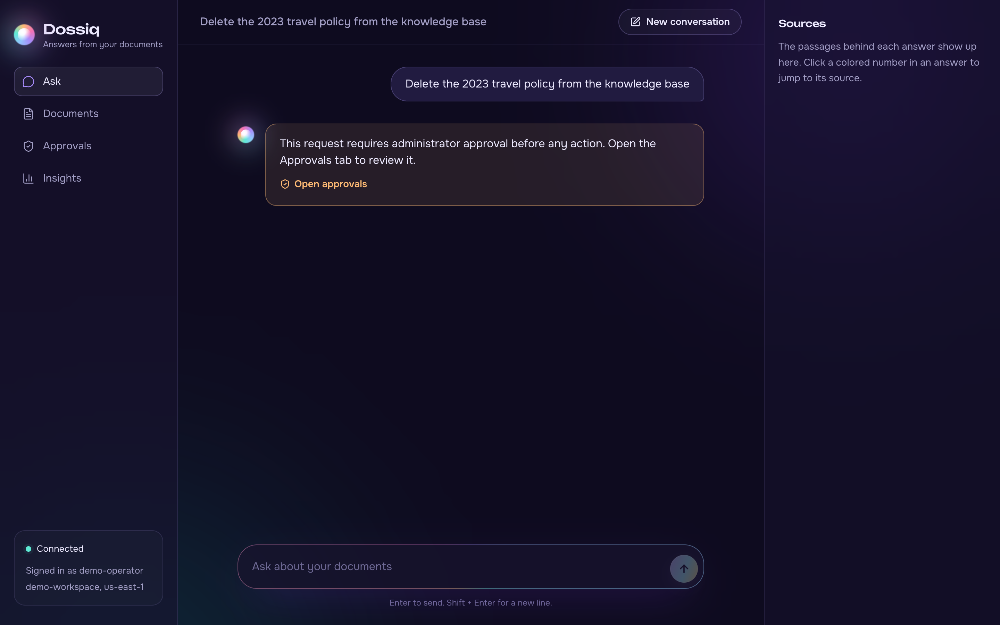</td>
    <td width="50%">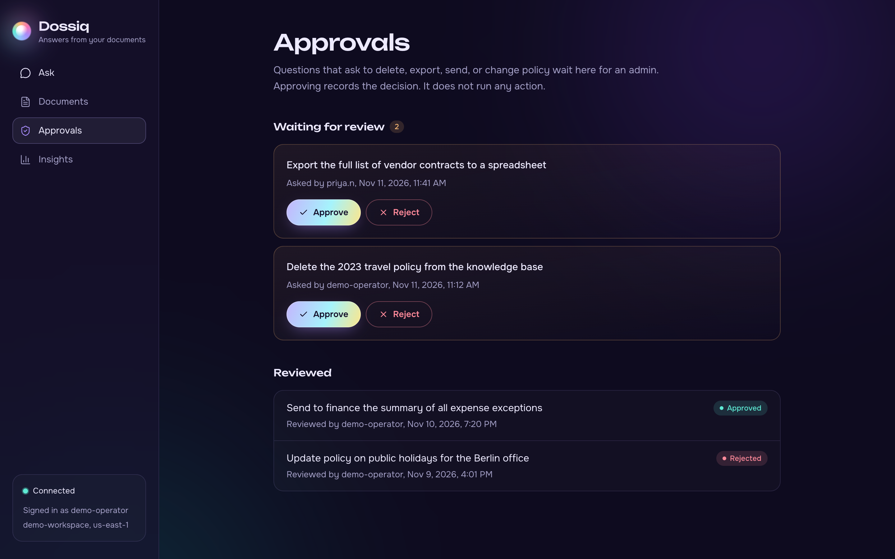</td>
  </tr>
  <tr>
    <td align="center"><sub>Risky requests are paused</sub></td>
    <td align="center"><sub>Admins approve or reject</sub></td>
  </tr>
</table>

### 5. See how it is used

Insights shows how many documents are ready, how people rate the answers, and how often the guardrails stepped in.

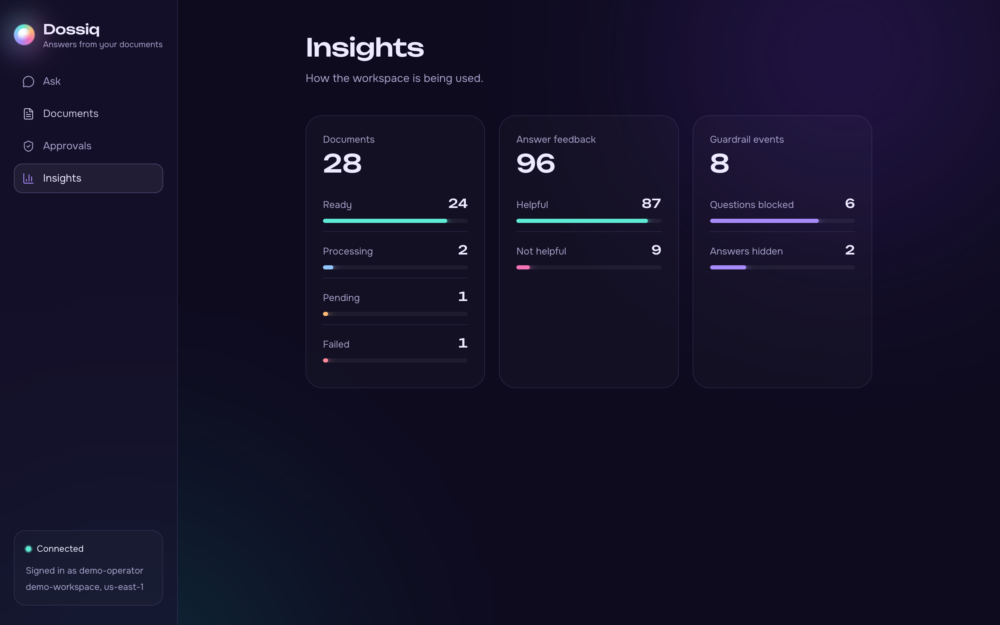

### 6. Works on your phone

On small screens, sources slide up from the bottom when you tap a citation.

<p align="center">
  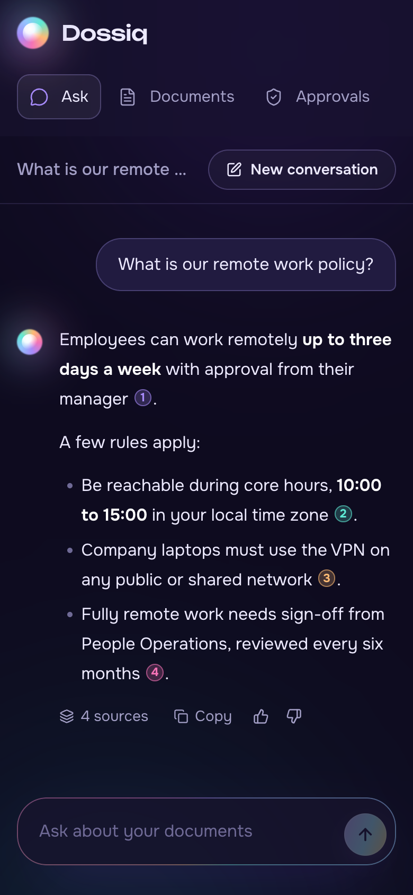
  &nbsp;&nbsp;&nbsp;
  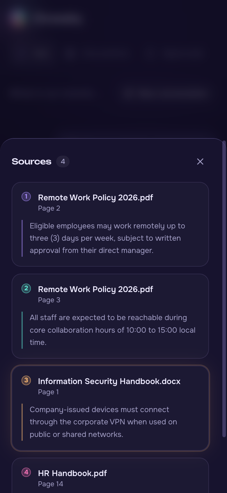
</p>

<br/>

## How it works

### The big picture

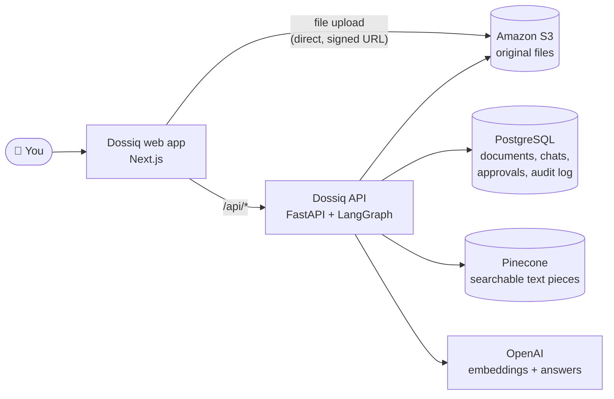

The web app never talks to the databases directly. It only calls the Dossiq API. Files are the one exception: the browser sends them straight to S3 using a short-lived signed link, so large files do not pass through the API.

### What happens when you upload a file

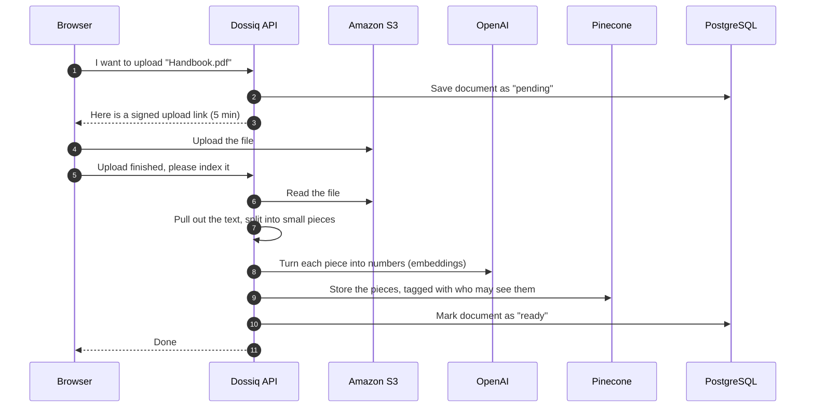

### What happens when you ask a question

Each question goes through a small pipeline built with LangGraph:

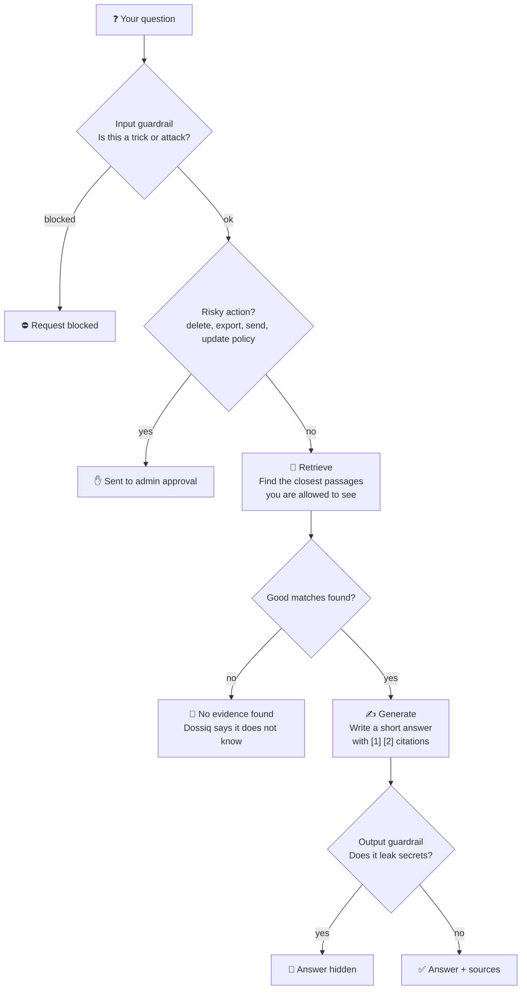

A few details that matter:

- **Follow-ups work** because the last question is added to the search when you ask something short like "summarize that".
- **Weak matches are dropped.** Only passages above a relevance score are used, so the answer stays on topic.
- **Documents are treated as data, not instructions.** Text inside a file cannot take control of the assistant.
- **Every workspace is separate.** Each one has its own space in Pinecone, and every database query is limited to one workspace.

<br/>

## Tech stack

| Layer | What we use | Why |
|---|---|---|
| Web app | Next.js 16, React 19, Tailwind CSS 4, TypeScript | Fast, modern UI |
| Motion and UI | Motion, Lucide icons, React Markdown | Smooth animation, clear icons, formatted answers |
| API | Python 3.14, FastAPI, uv | Simple, fast, typed |
| AI pipeline | LangGraph | Clear, step-by-step answer flow |
| Models | OpenAI `text-embedding-3-small`, `gpt-4o-mini` | Good quality at low cost |
| Search | Pinecone | Fast similarity search with access filters |
| Database | PostgreSQL | Documents, chats, approvals, audit log |
| File storage | Amazon S3 | Original uploaded files |
| Tracing | Rius (optional, off by default) | Traces timing only, never content |

<br/>

## Project layout

```
Dossiq/
├── enterprise-rag-backend/     The API
│   ├── app/
│   │   ├── main.py             API routes
│   │   ├── graph.py            The question-answering pipeline
│   │   ├── guardrails.py       Input and output safety checks
│   │   ├── vector.py           Pinecone search with access filters
│   │   ├── memory.py           Conversation history
│   │   └── aws.py              S3 and OpenAI clients
│   ├── worker/ingest.py        Read, split, and index a document
│   ├── infra/schema.sql        Database tables
│   └── scripts/init_db.py      Create the tables
│
├── enterprise-rag-frontend/    The web app
│   ├── app/                    Page shell, theme, fonts
│   ├── components/             Ask, Documents, Approvals, Insights
│   └── lib/api.ts              Typed API client
│
└── docs/images/                Logo and screenshots
```

<br/>

## Run it yourself

### What you need

- Python 3.14 and [uv](https://docs.astral.sh/uv/)
- Node.js 20 or newer
- A PostgreSQL database
- An Amazon S3 bucket, with a CORS rule that allows `PUT` from `http://localhost:3000`
- An OpenAI API key
- A Pinecone API key

### 1. Start the API

```bash
cd enterprise-rag-backend
cp .env.example .env          # then add your keys
uv sync
uv run python scripts/init_db.py
uv run uvicorn app.main:app --reload --host 127.0.0.1 --port 8000
```

The Pinecone index is created for you on first use. API docs live at http://127.0.0.1:8000/api/docs.

### 2. Start the web app

```bash
cd enterprise-rag-frontend
cp .env.example .env.local
npm install
npm run dev
```

Open http://localhost:3000 and upload your first document.

### Or start both at once

```bash
cd enterprise-rag-frontend
npm run dev:all
```

<br/>

## Settings

The API reads its settings from `enterprise-rag-backend/.env`. Never commit this file. It is already in `.gitignore`.

| Setting | What it does |
|---|---|
| `DATABASE_URL` | PostgreSQL connection |
| `AWS_ACCESS_KEY_ID`, `AWS_SECRET_ACCESS_KEY`, `AWS_REGION`, `S3_BUCKET` | Where uploaded files are stored |
| `OPENAI_API_KEY`, `OPENAI_EMBED_MODEL`, `OPENAI_CHAT_MODEL` | Which AI models to use |
| `EMBED_DIMENSION` | Size of each embedding. Must match the Pinecone index (default 1024) |
| `PINECONE_API_KEY`, `PINECONE_INDEX_NAME` | The search index |
| `CORS_ORIGINS` | Web addresses allowed to call the API |
| `RIUS_API_KEY` | Turns on tracing. Leave empty to keep it off |

Optional tuning: `MIN_RELEVANCE` (default 0.25), `MEMORY_TURNS` (default 6), `HITL_ENABLED` (default true), `MAX_UPLOAD_BYTES` (default 10 MB).

<br/>

## API at a glance

| Method | Path | What it does |
|---|---|---|
| `POST` | `/api/chat` | Ask a question |
| `GET` | `/api/conversations/{id}/messages` | Load a past conversation |
| `POST` | `/api/feedback` | Rate an answer |
| `POST` | `/api/documents/uploads` | Get a signed upload link |
| `POST` | `/api/documents/complete` | Index an uploaded file |
| `POST` | `/api/documents/{id}/abort` | Cancel an upload |
| `GET` | `/api/documents` | List documents |
| `GET` | `/api/approvals` | List approval requests (admin) |
| `POST` | `/api/approvals/{id}/decision` | Approve or reject (admin) |
| `GET` | `/api/admin/metrics` | Document and feedback counts |
| `GET` | `/api/admin/guardrails` | Guardrail counts (admin) |
| `GET` | `/health/live`, `/health/ready` | Health checks |

<br/>

## Good to know

Dossiq is currently a single-workspace demo. Before using it for real, keep in mind:

- **No login yet.** Everyone uses one built-in admin account.
- **Guardrails are rule-based.** They catch common attacks, but they are not a full safety service.
- **Approvals only record a decision.** Approving does not run the action.
- **Indexing happens while you wait.** Very large files keep the upload open until indexing finishes.
- **No OCR yet.** Scanned PDFs without a text layer cannot be read.

<br/>

<div align="center">
  
  <br/>
  <sub>Built with care for teams who want answers they can trust.</sub>
</div>
