<div align="center">


# Dossiq

**Ask your company documents anything. Get answers you can check.**

Dossiq reads your PDFs, Word files, and notes, then answers questions in plain language.<br/>
Every answer points to the exact page it came from. Every team gets its own private workspace.

<br/>

Designed and built by **[Syket Bhattachergee](https://syketb.vercel.app/)**

[](https://www.linkedin.com/in/syketb)
[](https://syketb.vercel.app/)
[](https://github.com/syket-git)

<br/>


<br/>


</div>

<br/>

## What is Dossiq?

Every company has answers buried in documents. Policies, handbooks, playbooks, guides. Finding the right line takes time, and people often guess.

Dossiq fixes that. A team creates a workspace, uploads its files once, and invites teammates. After that, anyone on the team can ask a question like *"How much paid time off do I get?"* and get a short, clear answer with the source attached.

What makes it trustworthy:

- **It only uses your documents.** It does not make things up from the internet.
- **It shows its work.** Each fact has a small colored number. Click it, and you see the exact passage and page.
- **It says when it does not know.** If nothing in your files covers the question, it tells you so.
- **Each team stays separate.** A workspace never sees another workspace's files, chats, or approvals.
- **Admins stay in control.** Risky requests wait for an admin, and only admins see the review queue and usage numbers.

<br/>

## Highlights

| | |
|---|---|
| 🎯 **Cited answers** | Every claim links to a page in a real document. Colors match the source cards. |
| 🏢 **Multiple workspaces** | One account, many teams. Switch workspaces in one click. Data never crosses over. |
| 🔑 **Real sign-in** | Email or Google login powered by Clerk. New users name themselves and their workspace. |
| 👥 **Roles** | Admins manage members, review requests, and see Insights. Members ask and upload. |
| ✋ **Approvals that answer back** | Risky requests wait for an admin. Once approved, the answer lands in the asker's chat by itself. |
| 🔒 **Private chats** | Each person's conversations belong to them, even inside a shared workspace. |
| 🧠 **Remembers the conversation** | Follow-ups like "summarize that" just work. Chats survive a page reload. |
| 🛡️ **Guardrails** | Blocks prompt-injection tricks. Hides answers that would leak keys or passwords. |
| 📜 **Audit trail** | Uploads, blocks, and decisions are all recorded per workspace. |
| ✨ **Polished UI** | Animated assistant, word-by-word answers, drag-and-drop uploads, works on phones. |

<br/>

## A walk through Dossiq

> The screenshots below are from a demo workspace for **Kestrel Ridge Outfitters**, a made-up outdoor gear company. The people (Maya Chen, Daniel Okafor) and documents are fictional, but every screen is the real app with real answers.
>
> - **Maya Chen** is Head of People Operations. She is the workspace **admin**.
> - **Daniel Okafor** runs store operations. He is a **member**.

### 1. Sign in and create a workspace

Maya signs in with email or Google. On her first visit, Dossiq asks her to name her team's workspace. She calls it **Kestrel Ridge**, and becomes its admin.

<table>
  <tr>
    <td width="50%">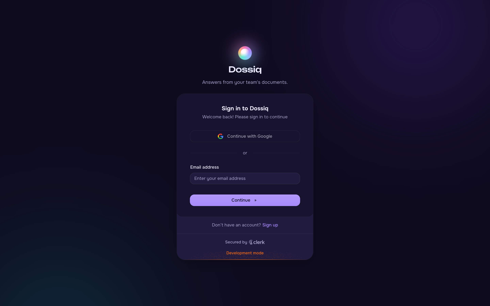</td>
    <td width="50%">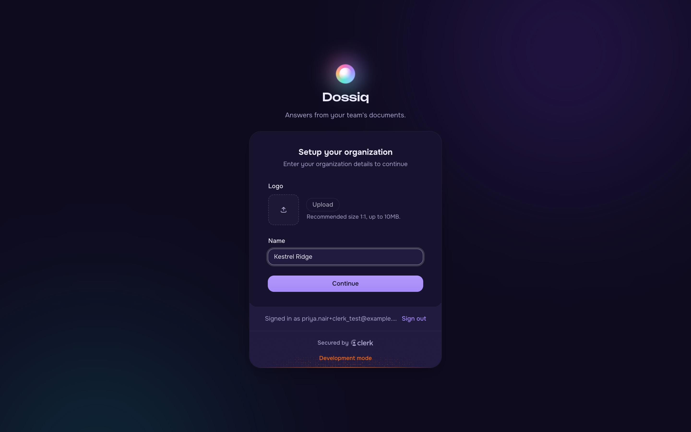</td>
  </tr>
  <tr>
    <td align="center"><sub>Sign in with email or Google</sub></td>
    <td align="center"><sub>Name the workspace on first visit</sub></td>
  </tr>
</table>

### 2. Upload the team's documents

Maya drops in the company handbook, the travel policy, the security policy, the store returns playbook, and the onboarding checklist. Dossiq shows each step while it uploads and indexes the file.

<table>
  <tr>
    <td width="50%"></td>
    <td width="50%"></td>
  </tr>
  <tr>
    <td align="center"><sub>The workspace library, all ready</sub></td>
    <td align="center"><sub>Three clear steps for every upload</sub></td>
  </tr>
</table>

### 3. Ask a question, check the answer

Maya is planning a supplier trip. She asks what she needs to know. The orb tells her what it is doing, then the answer appears word by word. Each colored number links to the exact page in the travel policy.

<table>
  <tr>
    <td width="50%"></td>
    <td width="50%"></td>
  </tr>
  <tr>
    <td align="center"><sub>Ready for a question</sub></td>
    <td align="center"><sub>Searching, reading, then writing</sub></td>
  </tr>
</table>


### 4. Invite the team and set roles

From the workspace menu, Maya opens **Manage** and invites Daniel as a **member**. Admins can change roles or remove people at any time.

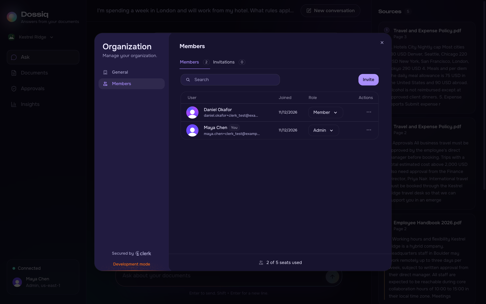

| Role | Ask and upload | See Approvals | Approve or reject | See Insights | Manage members |
|---|:---:|:---:|:---:|:---:|:---:|
| **Admin** | ✅ | ✅ | ✅ | ✅ | ✅ |
| **Member** | ✅ | | | | |

### 5. A member asks for something risky

Daniel only sees **Ask** and **Documents**. He gets normal answers right away. When he asks Dossiq to *send* something to his team, Dossiq does not act. It holds the request and tells him an admin will review it. Maya sees it in her queue, with Daniel's name on it.

<table>
  <tr>
    <td width="50%">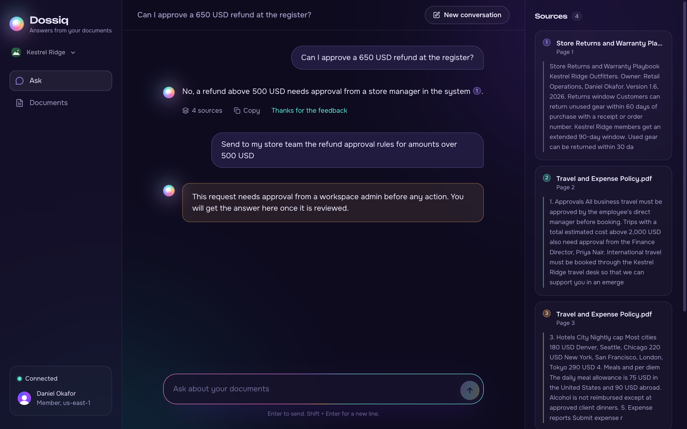</td>
    <td width="50%">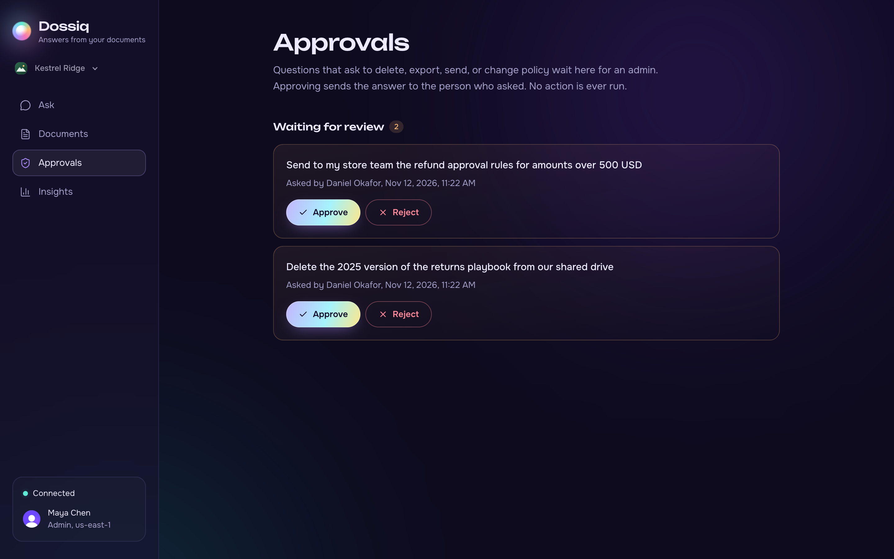</td>
  </tr>
  <tr>
    <td align="center"><sub>Daniel (member): the request is held</sub></td>
    <td align="center"><sub>Maya (admin): the review queue</sub></td>
  </tr>
</table>

### 6. Approve, and the answer arrives

Maya approves. Dossiq answers the question **with Daniel's own access rights**, not Maya's, and posts the answer into Daniel's chat. Daniel does not need to refresh. If Maya rejects it, Daniel gets a short note instead. Nothing is ever executed, only answered.

<table>
  <tr>
    <td width="50%"></td>
    <td width="50%">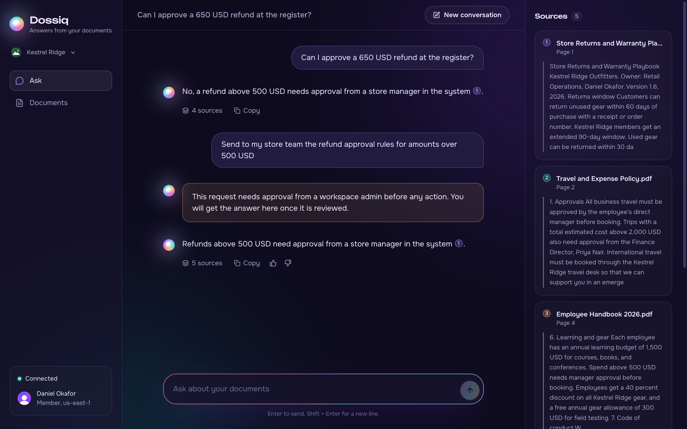</td>
  </tr>
  <tr>
    <td align="center"><sub>Reviewed by Maya Chen. Answer sent.</sub></td>
    <td align="center"><sub>The answer appears in Daniel's chat</sub></td>
  </tr>
</table>

### 7. Many workspaces, fully separate

Maya also runs **Kestrel Ridge Finance**, a second workspace with the confidential budget. She switches with one click. When she asks the Finance workspace about store returns, it finds nothing, because that playbook lives only in the main workspace.

<table>
  <tr>
    <td width="50%">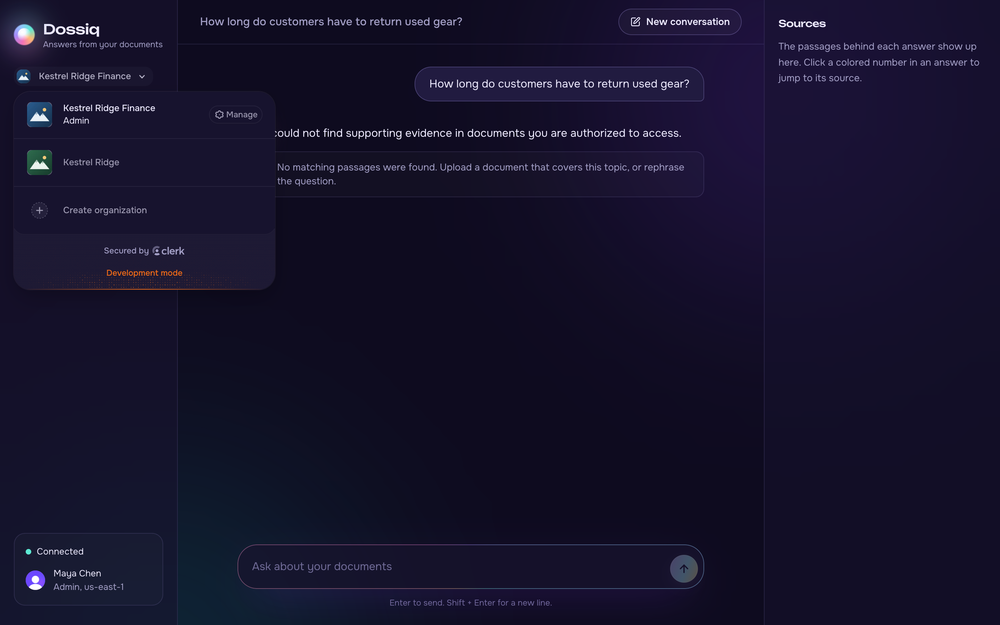</td>
    <td width="50%">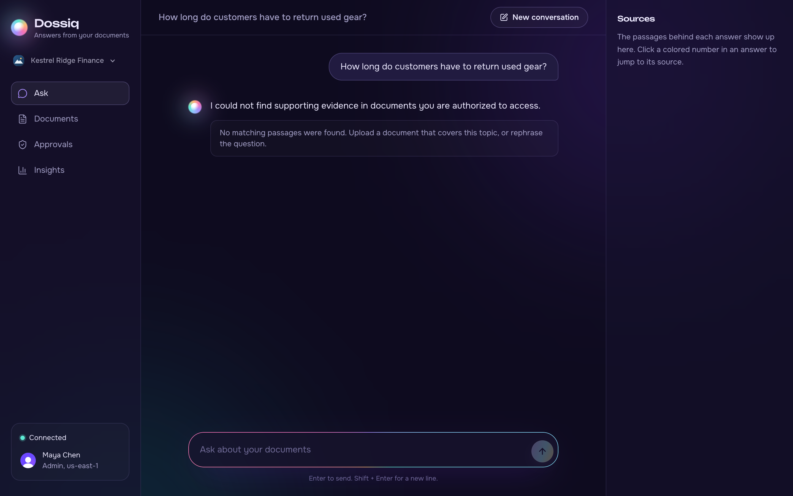</td>
  </tr>
  <tr>
    <td align="center"><sub>Switch between workspaces</sub></td>
    <td align="center"><sub>Finance cannot see the main workspace's files</sub></td>
  </tr>
</table>

### 8. See how the workspace is used

Insights is for admins. It shows document health, how people rate the answers, and how often the guardrails stepped in, for the current workspace only.


### 9. Works on your phone

On small screens, the navigation moves to the top, and sources slide up from the bottom when you tap a citation.

<p align="center">
  
  &nbsp;&nbsp;&nbsp;
  
</p>

<br/>

## How it works

### The big picture

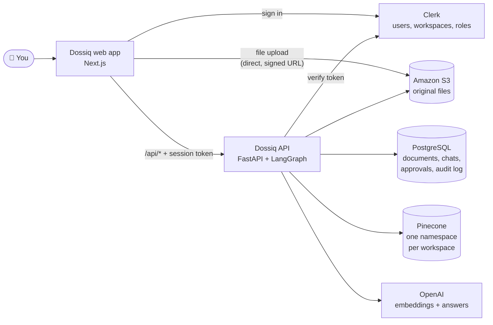

The web app never talks to the databases directly. It only calls the Dossiq API, which checks the Clerk session token on every request. Files are the one exception: the browser sends them straight to S3 using a short-lived signed link, so large files do not pass through the API.

### Who you are, and which workspace you are in

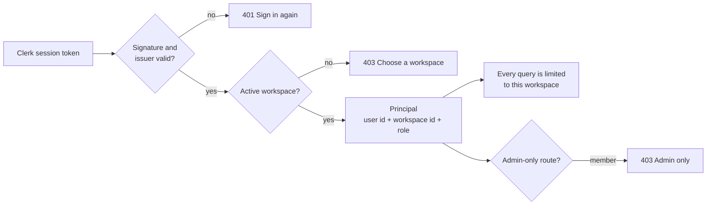

- **One Clerk Organization is one Dossiq workspace.** The workspace id becomes the tenant for every database query, every S3 path, and the Pinecone namespace.
- **Roles come from Clerk.** `admin` and `member` are checked on the server, not just hidden in the UI.
- **Chats are private.** Conversations are stored per user, so teammates cannot open each other's chats.

### What happens when you upload a file

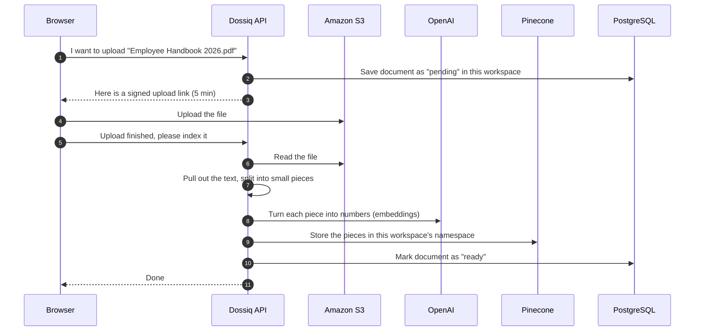

### What happens when you ask a question

Each question goes through a small pipeline built with LangGraph:


### What happens after an approval

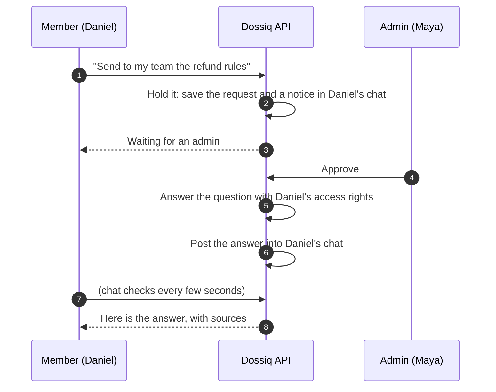

A few details that matter:

- **Follow-ups work** because the last question is added to the search when you ask something short like "summarize that".
- **Weak matches are dropped.** Only passages above a relevance score are used, so the answer stays on topic.
- **Documents are treated as data, not instructions.** Text inside a file cannot take control of the assistant.
- **Approvals never run actions.** Approving only lets Dossiq answer the question. It never deletes, exports, or sends anything.

<br/>

## Tech stack

| Layer | What we use | Why |
|---|---|---|
| Web app | Next.js 16, React 19, Tailwind CSS 4, TypeScript | Fast, modern UI |
| Sign-in and workspaces | Clerk (Organizations, roles) | Secure login, invites, and roles without building them |
| Motion and UI | Motion, Lucide icons, React Markdown | Smooth animation, clear icons, formatted answers |
| API | Python 3.14, FastAPI, uv, PyJWT | Simple, fast, typed. Verifies every session token |
| AI pipeline | LangGraph | Clear, step-by-step answer flow |
| Models | OpenAI `text-embedding-3-small`, `gpt-4o-mini` | Good quality at low cost |
| Search | Pinecone | Fast similarity search, one namespace per workspace |
| Database | PostgreSQL | Documents, chats, approvals, audit log |
| File storage | Amazon S3 | Original uploaded files |
| Tracing | Rius (optional, off by default) | Traces timing only, never content |

<br/>

## Project layout

```
Dossiq/
├── enterprise-rag-backend/       The API
│   ├── app/
│   │   ├── main.py               API routes
│   │   ├── auth.py               Clerk token check, workspace and role
│   │   ├── users.py              Look up display names from Clerk
│   │   ├── graph.py              The question-answering pipeline
│   │   ├── guardrails.py         Input and output safety checks
│   │   ├── vector.py             Pinecone search, one namespace per workspace
│   │   ├── memory.py             Private conversation history
│   │   └── aws.py                S3 and OpenAI clients
│   ├── worker/ingest.py          Read, split, and index a document
│   ├── infra/schema.sql          Database tables
│   └── scripts/
│       ├── init_db.py            Create or update the tables
│       └── migrate_workspace.py  Move old demo data into a real workspace
│
├── enterprise-rag-frontend/      The web app
│   ├── app/                      Page shell, sign-in, workspace picker
│   ├── components/               Ask, Documents, Approvals, Insights
│   ├── lib/api.ts                Typed API client (sends the session token)
│   └── proxy.ts                  Clerk session handling
│
└── docs/images/                  Logo and screenshots
```

<br/>

## Run it yourself

### What you need

- Python 3.14 and [uv](https://docs.astral.sh/uv/)
- Node.js 20 or newer
- A PostgreSQL database
- An Amazon S3 bucket, with a CORS rule that allows `PUT` from `http://localhost:3000`
- An OpenAI API key
- A Pinecone API key
- A free [Clerk](https://clerk.com) account

### 1. Set up Clerk

1. Create a Clerk application with **Email** and **Google** sign-in.
2. Turn on **Organizations**. Each organization becomes a Dossiq workspace.
3. Optional: under **User model**, require first and last name, so approvals show real names.
4. From **API keys**, copy the publishable key, the secret key, and the Frontend API URL.

### 2. Start the API

```bash
cd enterprise-rag-backend
cp .env.example .env          # then add your keys, including the Clerk ones
uv sync
uv run python scripts/init_db.py
uv run python -m uvicorn app.main:app --reload --host 127.0.0.1 --port 8000
```

The Pinecone index is created for you on first use. API docs live at http://127.0.0.1:8000/api/docs.

### 3. Start the web app

```bash
cd enterprise-rag-frontend
cp .env.example .env.local    # add the Clerk publishable and secret keys
npm install
npm run dev
```

Open http://localhost:3000, sign in, name your workspace, and upload your first document.

### Or start both at once

```bash
cd enterprise-rag-frontend
npm run dev:all
```

### Coming from the single-workspace version?

Old data was stored under `demo-workspace`. Move it into your new workspace once:

```bash
cd enterprise-rag-backend
uv run python scripts/migrate_workspace.py --to org_XXXX --owner user_XXXX
```

You can find both ids in the Clerk dashboard.

<br/>

## Settings

The API reads its settings from `enterprise-rag-backend/.env`, and the web app from `enterprise-rag-frontend/.env.local`. Never commit these files. They are already in `.gitignore`.

**API (`enterprise-rag-backend/.env`)**

| Setting | What it does |
|---|---|
| `DATABASE_URL` | PostgreSQL connection |
| `AWS_ACCESS_KEY_ID`, `AWS_SECRET_ACCESS_KEY`, `AWS_REGION`, `S3_BUCKET` | Where uploaded files are stored |
| `OPENAI_API_KEY`, `OPENAI_EMBED_MODEL`, `OPENAI_CHAT_MODEL` | Which AI models to use |
| `EMBED_DIMENSION` | Size of each embedding. Must match the Pinecone index (default 1024) |
| `PINECONE_API_KEY`, `PINECONE_INDEX_NAME` | The search index |
| `CLERK_ISSUER` | Your Clerk Frontend API URL, for example `https://your-app.clerk.accounts.dev` |
| `CLERK_JWKS_URL` | `CLERK_ISSUER` + `/.well-known/jwks.json`. Used to verify session tokens |
| `CLERK_SECRET_KEY` | Used to look up display names for approvals |
| `AUTH_MODE` | `clerk` (default). `demo` skips login with one built-in admin, for local testing only |
| `CORS_ORIGINS` | Web addresses allowed to call the API. Tokens from other sites are rejected |
| `RIUS_API_KEY` | Turns on tracing. Leave empty to keep it off |

Optional tuning: `MIN_RELEVANCE` (default 0.25), `MEMORY_TURNS` (default 6), `HITL_ENABLED` (default true), `MAX_UPLOAD_BYTES` (default 10 MB).

**Web app (`enterprise-rag-frontend/.env.local`)**

| Setting | What it does |
|---|---|
| `API_URL` | Where the FastAPI server runs (default `http://127.0.0.1:8000`) |
| `NEXT_PUBLIC_CLERK_PUBLISHABLE_KEY` | Clerk publishable key |
| `CLERK_SECRET_KEY` | Clerk secret key, used by the Next.js server |

<br/>

## API at a glance

Every route needs a Clerk session token, and works inside the active workspace.

| Method | Path | Who | What it does |
|---|---|---|---|
| `GET` | `/api/info` | Everyone | Current user, workspace, and role |
| `POST` | `/api/chat` | Everyone | Ask a question |
| `GET` | `/api/conversations/{id}/messages` | Owner of the chat | Load a past conversation |
| `POST` | `/api/feedback` | Everyone | Rate an answer |
| `POST` | `/api/documents/uploads` | Everyone | Get a signed upload link |
| `POST` | `/api/documents/complete` | Everyone | Index an uploaded file |
| `POST` | `/api/documents/{id}/abort` | Uploader | Cancel an upload |
| `GET` | `/api/documents` | Everyone | List documents |
| `GET` | `/api/approvals` | Admin | List approval requests, with names |
| `POST` | `/api/approvals/{id}/decision` | Admin | Approve (sends the answer) or reject |
| `GET` | `/api/admin/metrics` | Admin | Document and feedback counts |
| `GET` | `/api/admin/guardrails` | Admin | Guardrail counts |
| `GET` | `/health/live`, `/health/ready` | Public | Health checks |

<br/>

## Good to know

Dossiq now supports real sign-in, many workspaces, and roles. A few things to keep in mind:

- **Two roles for now.** Admin and member. A read-only viewer role is planned.
- **Approvals answer, they do not act.** Approving lets Dossiq answer the question. It never runs a delete, export, or send.
- **Risky requests are spotted by keywords.** Words like *delete*, *export*, *send to*, and *update policy* trigger an approval. Per-workspace rules are planned.
- **Everyone in a workspace sees all its documents.** Limiting a document to a group, like HR or Finance, is planned.
- **Guardrails are rule-based.** They catch common attacks, but they are not a full safety service.
- **Indexing happens while you wait.** Very large files keep the upload open until indexing finishes.
- **No OCR yet.** Scanned PDFs without a text layer cannot be read.

<br/>

## About the author

**Syket Bhattachergee** is a Forward Deployed Engineer building AI products. Syket designed and built Dossiq end to end: the AI pipeline, the API, the data layer, multi-workspace sign-in, and the interface.

- 💼 LinkedIn: [linkedin.com/in/syketb](https://www.linkedin.com/in/syketb)
- 🌐 Website: [syketb.vercel.app](https://syketb.vercel.app/)
- 🐙 GitHub: [@syket-git](https://github.com/syket-git)

Want to talk about AI products, RAG systems, or this project? Reach out on LinkedIn.

<br/>

<div align="center">
  
  <br/>
  <sub>Dossiq is designed and built by <a href="https://syketb.vercel.app/">Syket Bhattachergee</a>.</sub>
</div>
